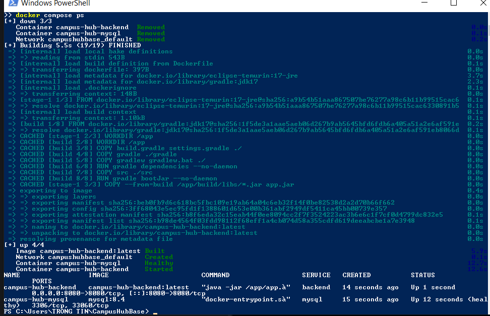
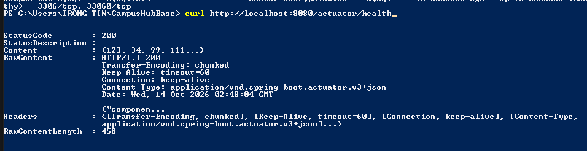
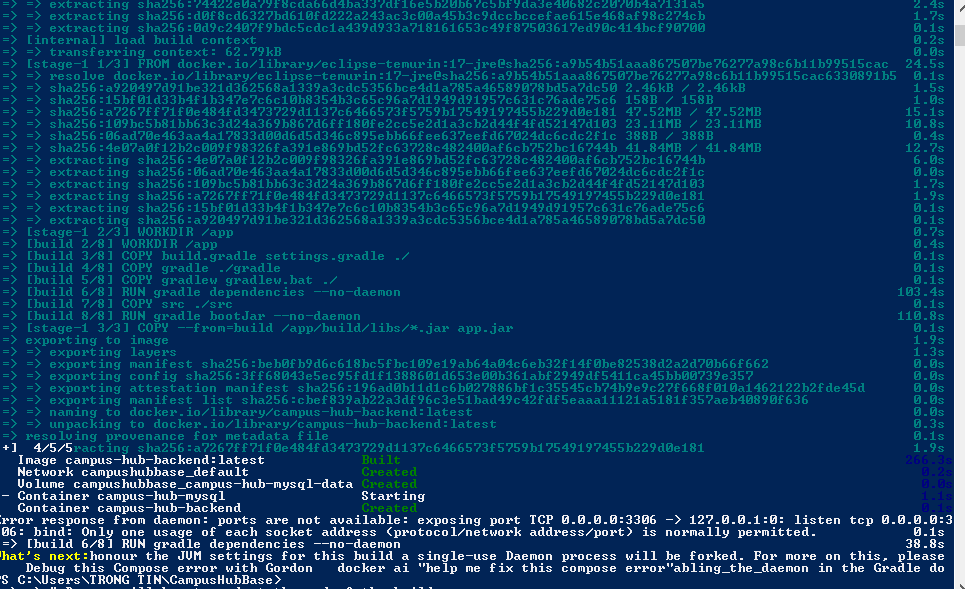

# Campus Hub Base

## Thong tin sinh vien

- Ho ten: TODO
- Ma sinh vien: TODO

## Chay kiem thu

```bash
./gradlew test
```

Tren Windows PowerShell:

```powershell
.\gradlew.bat test
```

## Build Docker Image

```bash
docker build -t campus-hub-backend .
docker images
```

## Chay he thong bang Docker Compose

```bash
docker compose up -d --build
docker compose ps
```

Backend duoc public tai:

```text
http://localhost:8080
```

Kiem tra health endpoint:

```bash
curl http://localhost:8080/actuator/health
```

Ket qua hop le can co HTTP 200 va trang thai `UP`.

## Minh chung

### 1. Docker Image da build thanh cong



### 2. Trang thai service sau khi chay Docker Compose



### 3. Ket qua goi /actuator/health


